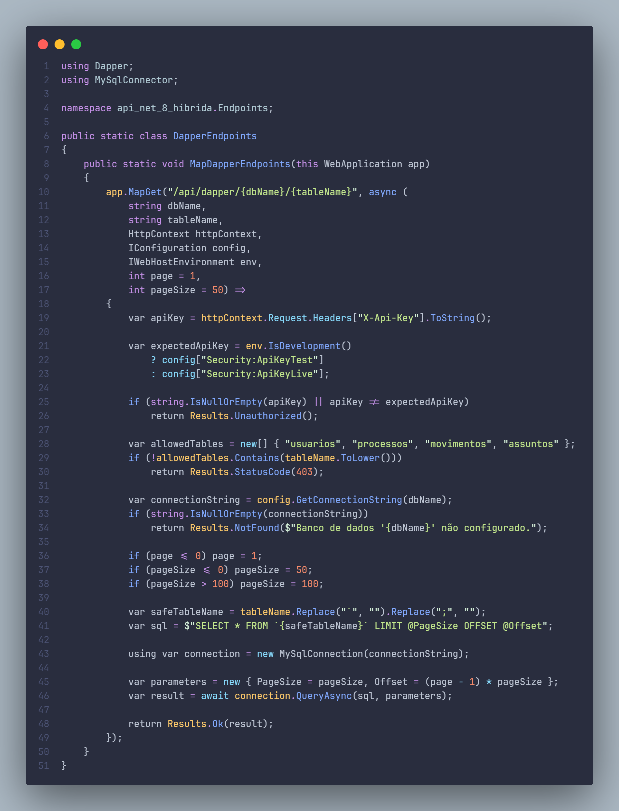

<div align="center">
  
</div>

<br>

<h1 align="center">API Híbrida (.NET 8 + Dapper)</h1>

<p align="center">
  API genérica para integração System-to-System (S2S) focada em consultas dinâmicas de bancos de dados relacionais.
</p>

<p align="center">
  
  
  
  
</p>

---

## 🚀 Tecnologias
- **.NET 8** (Minimal APIs)
- **Dapper** (Micro-ORM para alta performance)
- **MySqlConnector**
- **AspNetCoreRateLimit** (Proteção contra abusos)

## 🔒 Segurança e Ambientes
- **Autenticação:** Via API Keys (`sk_test_...` para dev, `sk_live_...` para prod).
- **Whitelist:** Somente tabelas pré-aprovadas podem ser consultadas.
- **Isolamento:** Configuração de portas e bancos de dados distintos para Produção (5000) e Desenvolvimento (5001).

## ⚙️ Como executar localmente

1. Clone o repositório:
   ```bash
   git clone https://github.com/SEU_USUARIO/api-net-8-hibrida.git
   ```
2. Copie o arquivo `appsettings.Development.example.json` e renomeie para `appsettings.Development.json`.
3. Preencha com sua chave de teste e a string de conexão do seu banco local.
4. Execute a API:
   ```bash
   dotnet run --urls "http://localhost:5001"
   ```

## 🛣️ Endpoint Principal

**`GET /api/dapper/{dbName}/{tableName}?page=1&pageSize=50`**

*Requer o cabeçalho `X-Api-Key`.*

```bash
curl -i -H "X-Api-Key: sk_test_123456789_ChaveDeTeste" \
"http://localhost:5001/api/dapper/mysql_datajud/usuarios"
```

---
<p align="center">
  Desenvolvido por <a href="https://github.com/SEU_USUARIO">Leonardo Firme</a>
</p>
